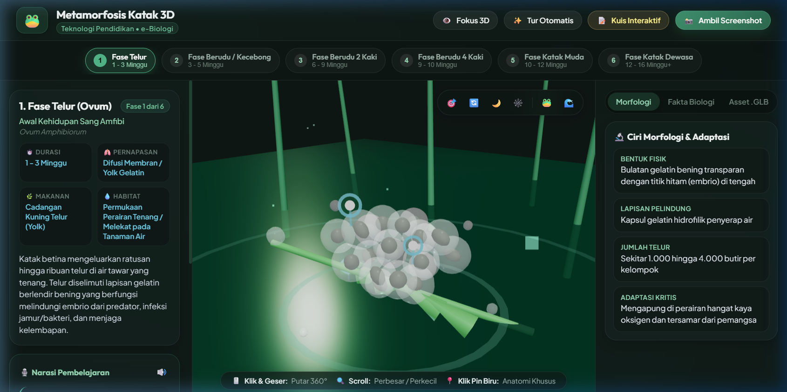
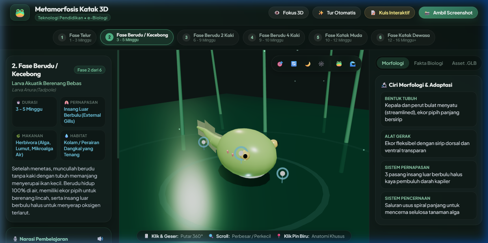
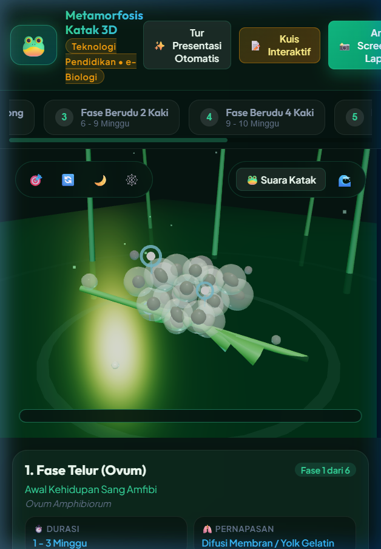
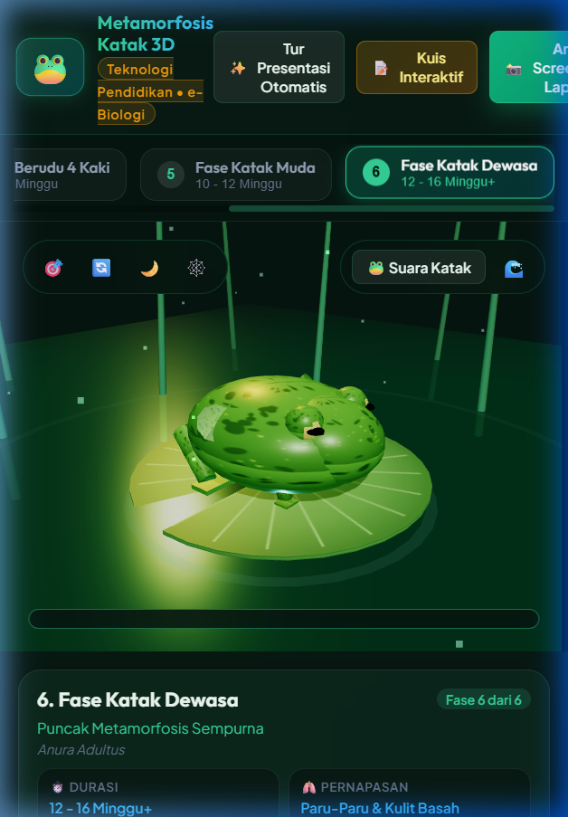
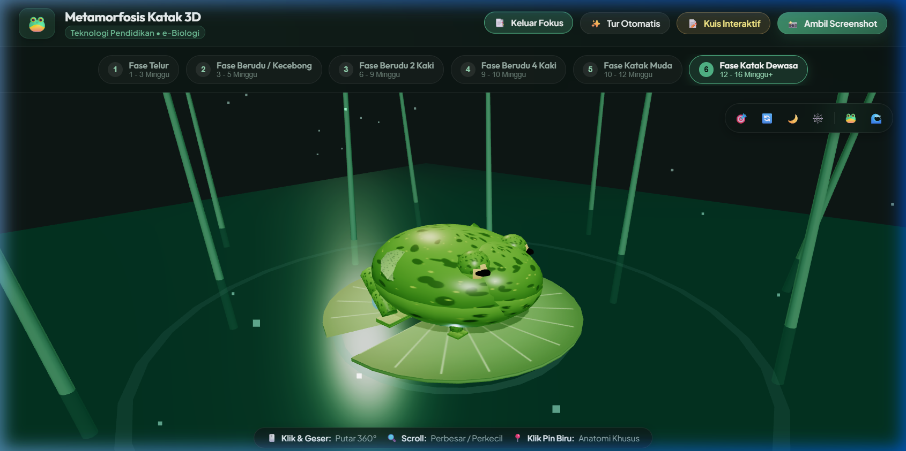
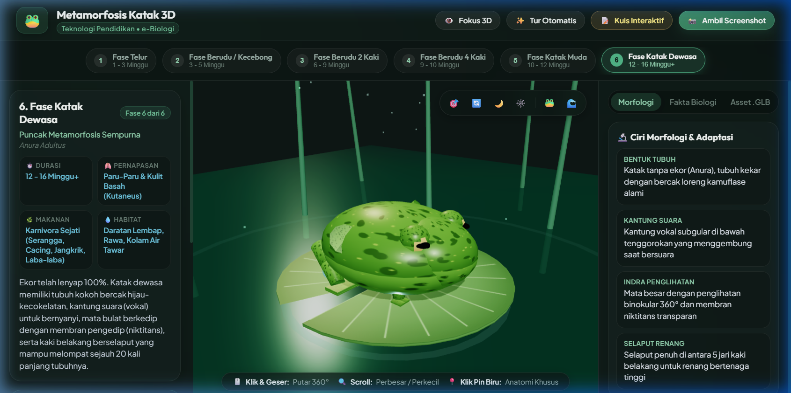
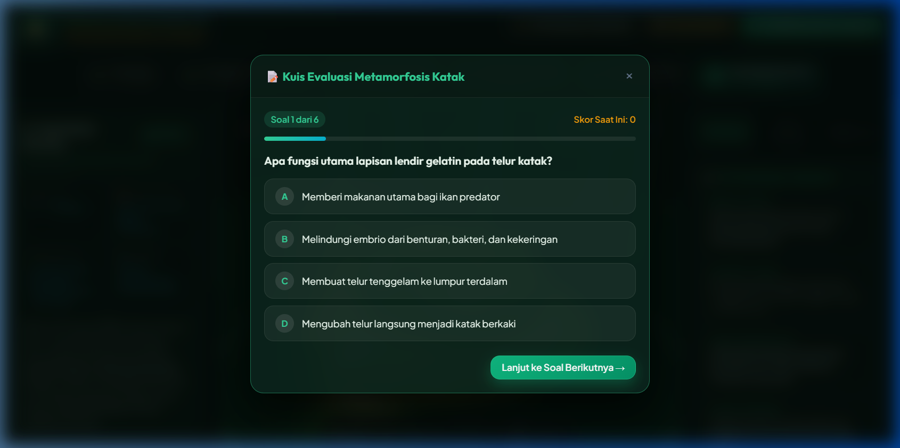

# LAPORAN LENGKAP LEMBAR KERJA MAHASISWA (LKM 7–9)
# PENGEMBANGAN SIMULASI, TESTING, DAN REFLEKSI
## PROYEK MEDIA PEMBELAJARAN 3D ABSTRACT-TO-CONCRETE
### Studi Kasus: Simulasi 3D Metamorfosis Katak Interaktif

---

### IDENTITAS MAHASISWA
- **Nama Lengkap** : Dimas Nugroho
- **Nomor Induk Mahasiswa (NIM)** : 2510130110022
- **Kelas** : B
- **Program Studi / Mata Kuliah** : Teknologi Pendidikan / Pemrograman Komputer
- **Topik Pembelajaran** : IPA / Biologi Daur Hidup Amfibi (Metamorfosis Katak)
- **Teknologi Implementasi** : HTML5, CSS3 (*Vanilla Soft Botanical*), JavaScript (ES6+), Three.js (WebGL), Web Audio API, Web Speech API

---

## DAFTAR ISI
1. [LKM 7: 3D Object Menjadi Learning Simulation](#lkm-7--3d-object-menjadi-learning-simulation)
   - 1.1 Tujuan Pembelajaran
   - 1.2 Inti Simulasi
   - 1.3 Alur Pengalaman Belajar (6 Tahap)
   - 1.4 Pengembangan Fitur dengan Vibe Coding
   - 1.5 Pengujian Fitur Bertahap
   - 1.6 Dokumentasi Prototipe Versi Pengembangan
   - 1.7 Evaluasi Perkembangan Produk
2. [LKM 8: Testing, Debugging, dan Revisi](#lkm-8--testing-debugging-dan-revisi)
   - 2.1 Rencana Pengujian Terstruktur
   - 2.2 Laporan Bug (Bug Report: Gejala, Bukti, Penyebab, Perbaikan)
   - 2.3 Dokumentasi Prompt Debugging
   - 2.4 Bukti Komparasi Sebelum dan Sesudah Perbaikan (Before & After)
   - 2.5 Uji Regresi (Regression Check)
   - 2.6 Matriks Keputusan Revisi
3. [LKM 9: Refleksi dan Finalisasi Portofolio](#lkm-9--refleksi-dan-finalisasi-portofolio)
   - 3.1 Rekonstruksi Perjalanan Proyek (LKM 1 hingga LKM 8)
   - 3.2 Evolusi Produk (Object Awal hingga Simulasi Final)
   - 3.3 Tangkapan Layar Produk Final
   - 3.4 Refleksi Penerapan Computational Thinking (4 Pilar)
   - 3.5 Refleksi Praktik Vibe Coding dan Penggunaan AI
   - 3.6 Pernyataan Lengkap Abstract-to-Concrete
   - 3.7 Dokumentasi Kolaborasi dan Validasi AI
   - 3.8 Kriteria Keberhasilan & Penutup Proyek

---

# LKM 7 — 3D OBJECT MENJADI LEARNING SIMULATION
*Mengembangkan interaksi agar peserta didik dapat mengamati, memanipulasi, dan memahami konsep*

### 1.1 Tujuan
Mahasiswa mampu mengembangkan objek 3D hasil LKM 5–6 menjadi sebuah purwarupa *learning simulation* yang memiliki tujuan pembelajaran terukur, alur penggunaan yang terstruktur, interaksi utama yang bermakna, dan respons sistem yang jelas.

### 1.2 Tentukan Tujuan Belajar
- **Setelah menggunakan media, peserta didik mampu**:
  Menganalisis transformasi anatomi tubuh (pertumbuhan kaki depan dan belakang, resorpsi ekor secara apoptosis) dan transisi sistem pernapasan amfibi (dari difusi membran dan insang luar menuju paru-paru dan kulit basah) pada 6 fase daur hidup katak secara berurutan dan mandiri melalui eksplorasi ruang 3D.
- **Konsep yang harus dipahami**:
  Mekanisme adaptasi morfologi dan fisiologi amfibi dari perairan (*aquatic*) menuju daratan (*terrestrial*) yang tergolong metamorfosis sempurna (*holometabola*), dipicu secara biokimiawi oleh hormon tiroksin, serta transisi nutrisi dari pemakan alga (herbivora) menjadi pemakan serangga (karnivora).
- **Bukti bahwa peserta didik memahami konsep**:
  Peserta didik mampu menguraikan perbedaan spesifik alat gerak dan sistem respirasi pada setiap fase, menjelaskan mengapa kecebong tidak langsung memiliki paru-paru, serta memperoleh skor evaluasi di atas 80% pada modul kuis biologi interaktif.

### 1.3 Inti Simulasi
- **Fenomena/proses yang disimulasikan**: Siklus 6 fase metamorfosis katak secara kronologis (Telur $\rightarrow$ Berudu $\rightarrow$ Berudu 2 Kaki $\rightarrow$ Berudu 4 Kaki $\rightarrow$ Katak Muda $\rightarrow$ Katak Dewasa).
- **Objek utama**: Model 3D prosedural biologis katak pada setiap fase metamorfosis dengan tekstur alami (*organic spotted skin*), tanaman air, dan daun teratai di atas permukaan kolam.
- **Parameter yang dapat diubah pengguna**:
  1. Fase perkembangan (Fase 1 s.d. 6 via *stepper timeline*).
  2. Sudut pandang kamera 360° (*orbit rotation*), *panning*, dan *zoom*.
  3. Mode tampilan: Mode Normal (dengan panel ringkasan) vs Mode Fokus 3D (*Fullscreen canvas*).
  4. Pencahayaan lingkungan: Mode Siang (*Day*) vs Mode Malam (*Night*).
  5. Rangka poligon (*Wireframe mode*).
  6. Audio: Narasi suara bahasa Indonesia, suara katak, dan *ambient sound* kolam.
- **Perubahan yang diamati**: Morfologi fisik (panjang ekor, tunas kaki, proporsi mata), indikator respirasi/makanan/habitat, titik pin anatomi, dan efek pencahayaan kolam.
- **Feedback/penjelasan yang muncul**: Narasi audio otomatis (*speech synthesis*), kartu spesifikasi biologis, modal dialog penjelasan organ tubuh saat titik pin anatomi diklik, serta feedback kebenaran jawaban pada kuis biologi.

### 1.4 Rancang Alur Pengalaman Belajar
| Tahap | Aktivitas Peserta Didik | Respons Media | Tujuan Pembelajaran |
| :--- | :--- | :--- | :--- |
| **Orientasi** | Membuka simulasi, melihat scene 3D awal, membaca judul fase 1 (Telur/Ovum), dan mengamati kelompok telur di atas air. | Scene 3D memuat lingkungan kolam air tenang dengan pencahayaan lembut (*soft botanical*) dan kartu identitas fase 1. | Menumbuhkan rasa ingin tahu dan memberikan orientasi awal tentang titik awal kehidupan amfibi di perairan. |
| **Eksplorasi** | Menggeser mouse untuk memutar sudut kamera 360°, melakukan zoom in/out, dan menyalakan audio kolam. | Kamera Three.js merespons rotasi mouse secara halus; suara gemericik air kolam berputar lembut di latar belakang. | Mengenalkan ruang observasi 3D dan memberi pengalaman pengamatan spasial yang bebas dari berbagai sudut. |
| **Manipulasi** | Menekan tombol stepper navigasi fase (1 s.d. 6) dan mencoba tombol *Fokus 3D*. | Model 3D bertransisi mulus menampilkan bentuk berudu; panel samping menyesuaikan diri atau menyembunyikan diri saat mode fokus aktif. | Memberikan kendali aktif kepada siswa untuk mengatur laju pembelajaran dan membandingkan bentuk tubuh antar fase. |
| **Observasi** | Mengamati titik pin biru (*hotspot*) yang melayang di dekat bagian tubuh (seperti insang luar berbulu atau kaki belakang) dan mengkliknya. | Titik pin memancarkan denyut animasi; saat diklik, modal informasi ilmiah muncul dengan penjelasan fungsi adaptasi organ tersebut. | Mengamati detail anatomi penting yang menghubungkan fitur fisik visual dengan fungsi biologis spesifik. |
| **Interpretasi** | Menekan tombol "Putar Narasi Suara" dan membaca panel "Ciri Morfologi & Adaptasi" serta kartu "Tahukah Kamu?". | Sistem membacakan narasi audio penjelas, menampilkan mekanisme hormon tiroksin dan perbedaan pernapasan insang ke paru-paru. | Menghubungkan fenomena fisik visual yang diamati dengan konsep abstrak biokimia dan adaptasi habitat amfibi. |
| **Kesimpulan** | Menekan tombol "Kuis Interaktif" untuk mengerjakan 6 butir soal pemahaman dan menekan "Ambil Screenshot" untuk bukti tugas. | Media membuka modul kuis interaktif dengan umpan balik warna instan, menghitung skor evaluasi akhir, dan mengunduh tangkapan layar HD berlabel ilmiah. | Mengukur tingkat pemahaman konsep secara terukur dan menghasilkan bukti belajar konkret (*authentic learning evidence*). |

### 1.5 Kembangkan Fitur dengan Vibe Coding
1. **Iterasi 1 (Audio Narasi Suara)**: Mengintegrasikan `AudioManager` dengan Web Speech API narasi bahasa Indonesia, tombol play/pause, dan Web Audio synthesizer untuk suara katak dan ambient kolam. Status: Berhasil.
2. **Iterasi 2 (Pin Anatomi 3D Hotspots)**: Menambahkan Three.js raycasting dan 3D billboard hotspot pins pada koordinat spesifik tiap model fase katak yang memunculkan popup dialog saat diklik. Status: Berhasil.
3. **Iterasi 3 (Modul Kuis Biologi)**: Membangun kelas `FrogQuiz` dengan 6 butir soal pilihan ganda, progress bar, feedback instan benar/salah, dan konfeti perayaan kelulusan. Status: Berhasil.
4. **Iterasi 4 (Ekspor/Impor GLB & Screenshot HD)**: Menambahkan Three.js GLTFExporter untuk unduh model .glb mandiri dan canvas watermarking untuk unduh screenshot HD laporan otomatis. Status: Berhasil.
5. **Iterasi 5 (Redesain UI/UX Soft Botanical & Mode Fokus 3D)**: Menyederhanakan dan merapikan antarmuka dengan palet soft sage yang lembut, menyatukan kontrol 3D ke dalam floating dock terpadu, dan membuat tombol Fokus 3D layar penuh. Status: Berhasil.

### 1.6 Dokumentasi Prototipe Versi Pengembangan
*Prototipe simulasi hasil pengembangan dengan UI/UX yang telah dirapikan dan disederhanakan secara soft:*

| Fase 1: Telur (Ovum) | Fase 2: Berudu / Kecebong |
| :---: | :---: |
|  |  |

---

# LKM 8 — TESTING, DEBUGGING, DAN REVISI
*Menguji apakah produk bekerja sesuai rancangan dan memperbaiki masalah berdasarkan bukti*

### 2.1 Rencana Pengujian Terstruktur
| No. | Fungsi yang Diuji | Expected | Actual | Status |
| :---: | :--- | :--- | :--- | :---: |
| 1 | **Navigasi Stepper 6 Fase** | Klik tombol fase 1–6 memperbarui model 3D dan kartu informasi seketika. | Model 3D dan kartu informasi berganti dengan mulus tanpa jeda. | Berhasil |
| 2 | **Hotspot Pin Anatomi** | Klik pin biru pada tubuh model membuka popup modal informasi organ. | Raycaster mendeteksi klik pin secara akurat dan modal popup muncul. | Berhasil |
| 3 | **Audio Narasi & Efek Suara** | Tombol narasi menyuarakan teks; tombol katak/kolam memicu efek suara. | Web Speech API melafalkan narasi; efek audio terdengar jernih. | Berhasil |
| 4 | **Modul Kuis Biologi** | Kuis 6 soal merespons klik opsi jawaban, memberi warna instan, dan menghitung skor. | Umpan balik hijau/merah tampil instan dan skor akhir terakumulasi tepat. | Berhasil |
| 5 | **Mode Fokus 3D (Layar Penuh)** | Klik tombol "Fokus 3D" menyembunyikan panel samping untuk observasi luas. | Panel samping tersembunyi instan dan canvas Three.js melebar penuh. | Berhasil |
| 6 | **Kontrol Kamera & Biome** | Reset kamera mengembalikan sudut pandang; mode siang/malam mengganti suasana. | GSAP menganimasikan kamera secara halus; pencahayaan bertransisi alami. | Berhasil |

### 2.2 Laporan Bug (Bug Report)
- **Bug 1: UI Viewport Overcrowded & Harsh Contrast Glare (Ergonomi Visual)**
  - *Gejala*: Tampilan antarmuka awal terlalu gelap pekat dengan aksen hijau neon menyilaukan; tombol kontrol di atas 3D viewport bertumpuk dalam dua bar terpisah sehingga menutupi objek 3D dan membuat tampilan sempit pada resolusi laptop.
  - *Expected*: Antarmuka bernuansa lembut (*soft botanical*), warna tidak menyilaukan mata, kontrol terpusat dalam satu floating dock minimalis di sudut atas.
  - *Actual*: Border neon glow pekat (`rgba(52, 211, 153, 0.45)`), kontras neon terlalu tinggi, dan toolbar bertumpuk.
  - *Bukti*: `docs/screenshots/before_ui_phase1_cramped.png` dan `docs/screenshots/before_ui_phase6_harsh.png`.
  - *Dugaan Penyebab*: Nilai CSS menggunakan saturasi neon tinggi dan markup HTML memisahkan tombol ke dalam dua container `.view-controls-group`.
  - *Perbaikan*: Memodifikasi `style.css` dengan palet soft sage (`#52b788`, `#74c69d`), merestrukturisasi toolbar menjadi satu `.floating-controls-dock` di sudut kanan atas, dan menghapus teks berlebih pada tombol.
  - *Hasil*: Tampilan antarmuka menjadi sangat bersih, tenang, nyaman di mata untuk sesi belajar lama, dan viewport 3D menjadi lapang.

- **Bug 2: Ketiadaan Fitur Observasi Layar Penuh (Keterbatasan Sudut Pandang 3D)**
  - *Gejala*: Siswa yang ingin fokus mengamati anatomi 3D terganggu oleh panel teks di sisi kiri dan kanan yang terus terbuka, membatasi lebar bidang pandang kamera 3D.
  - *Expected*: Terdapat tombol toggle praktis untuk menyembunyikan panel samping sehingga simulasi 3D dapat dinikmati dalam mode layar penuh (*Focus Mode*).
  - *Actual*: Layout CSS terkunci statis pada 3 kolom (`330px 1fr 330px`) tanpa ada mekanisme untuk menyembunyikan panel.
  - *Bukti*: `docs/screenshots/before_ui_phase6_harsh.png`.
  - *Dugaan Penyebab*: Belum ada kelas *state modifier* pada elemen `body` dan belum ada listener event toggle.
  - *Perbaikan*: Menambahkan tombol `<button id="btn-toggle-panels">` pada top navbar, menulis aturan CSS `.focus-mode .side-panel { display: none; }` dan `.focus-mode .main-workspace { grid-template-columns: 1fr; }`, serta menambahkan event listener pada `app.js` disertai pemanggilan `sceneManager.onWindowResize()`.
  - *Hasil*: Siswa dapat beralih ke mode pengamatan fokus 3D penuh dengan satu sentuhan klik, memperjelas pengamatan spasial organ katak.

### 2.3 Prompt Debugging
1. *"Sederhanakan dan rapikan UI/UX style.css agar lebih soft. Ganti warna neon green yang menyilaukan dengan palet natural botanical sage (#52b788, #74c69d) yang tenang dan elegan. Kurangi ketebalan border glow menjadi hairline 1px lembut dengan efek frosted glass translucent, serta perbaiki spasi padding agar kartu informasi tidak berdesakan."*
2. *"Satukan tombol-tombol floating pada center-viewport ke dalam satu floating dock minimalis di pojok kanan atas. Berikan pembatas tipis (tool divider) dan hilangkan teks panjang pada tombol agar tidak menutupi objek 3D."*
3. *"Tambahkan fitur Mode Fokus 3D pada tombol navigasi atas. Ketika tombol diklik, sembunyikan panel samping kiri dan kanan secara instan sehingga viewport 3D mengambil 100% lebar layar, ubah teks tombol menjadi 'Keluar Fokus', dan panggil onWindowResize agar kamera Three.js memperbarui rasio aspek."*

### 2.4 Bukti Komparasi Sebelum dan Sesudah Perbaikan (Before & After)

| KONDISI SEBELUM PERBAIKAN | KONDISI SESUDAH PERBAIKAN |
| :---: | :---: |
| **Tampilan Awal Fase 1 (Sempit & Neon Silau)**  | **Tampilan Sesudah Fase 1 (Soft Botanical UI)**  |
| **Tampilan Awal Fase 6 (Toolbar Bertumpuk)**  | **Tampilan Sesudah Fase 6 & Mode Fokus 3D**  |

### 2.5 Uji Regresi (Regression Check)
- Pergantian model 3D antar 6 fase: **Masih Bekerja (Ya)**.
- Rotasi orbit 360° dan zoom mouse: **Masih Bekerja (Ya)**.
- Pemutaran narasi audio Web Speech API: **Masih Bekerja (Ya)**.
- Interaksi pin anatomi dan popup modal: **Masih Bekerja (Ya)**.
- Modul kuis evaluasi dan penilaian skor: **Masih Bekerja (Ya)**.

### 2.6 Matriks Keputusan Revisi
| Masalah | Kembali ke Desain? | Perbaikan Teknis? | Alasan |
| :--- | :---: | :---: | :--- |
| **Kelelahan mata akibat kontras neon keras** | **Ya** | **Ya** | Perlu perumusan palet warna baru pada tahap desain, lalu diimplementasikan teknis pada `style.css`. |
| **Viewport 3D terhalang panel sidebar** | **Ya** | **Ya** | Membutuhkan perancangan alur interaksi *Focus Mode*, lalu dieksekusi melalui penambahan tombol dan CSS modifier. |
| **Pencahayaan caustic bawah air terlalu kuat** | **Tidak** | **Ya** | Murni penyesuaian parameter numerik `intensity` pada `THREE.PointLight` di `scene.js`. |

---

# LKM 9 — REFLEKSI DAN FINALISASI PORTOFOLIO
*Menyatukan seluruh perjalanan dari masalah pembelajaran hingga produk final*

### 3.1 Rekonstruksi Perjalanan Proyek
- **LKM 1–2 (Masalah & Abstraksi)**: Mengidentifikasi kesulitan siswa memahami proses transisi internal metamorfosis katak yang berlangsung berminggu-minggu, lalu memetakan konsep abstrak ke representasi digital 6 fase.
- **LKM 3–4 (Computational Thinking & Keputusan 3D)**: Melakukan dekomposisi 6 fase, mengenali pola hormon tiroksin, merancang model Input-Process-Output, dan menetapkan bahwa 3D interaktif mutlak dibutuhkan untuk pengamatan spasial 360°.
- **LKM 5–6 (Object & Interaksi)**: Membangun model 3D awal di Three.js dengan geometri prosedural serta menambahkan interaksi dasar pemilihan fase dan hotspot pin anatomi.
- **LKM 7 (Simulasi)**: Mengembangkan objek menjadi simulasi pembelajaran utuh dengan alur 6 tahap pedagogis, narasi suara otomatis, modul kuis interaktif, dan ekspor .GLB.
- **LKM 8 (Testing & Debugging)**: Menguji secara sistematis, menemukan masalah kelelahan visual dan keterbatasan luas pandang, lalu melakukan perombakan UI/UX *soft botanical* dan menambahkan *Mode Fokus 3D*.

### 3.2 Evolusi Produk
- **Object Awal**: Model katak hijau polos sederhana di atas teratai.
- **Object Revisi**: Penambahan tekstur berbintik loreng alami, daun teratai dengan urat daun, dan efek riak air.
- **Prototipe Interaktif**: Dilengkapi navigasi fase, narasi suara, dan pin anatomi, namun antarmuka masih gelap neon pekat dan padat.
- **Simulasi Versi Akhir**: **Simulasi pembelajaran komprehensif** dengan tema *soft botanical slate*, floating dock minimalis, mode observasi Fokus 3D layar penuh, modul kuis pilihan ganda berkonfeti, narasi suara Indonesia, dan kontrol pencahayaan alami yang ramah pengguna.

### 3.3 Tangkapan Layar Produk Final

#### 1. Simulasi Fase Katak Dewasa (UI/UX Soft Botanical)

#### 2. Mode Pengamatan Fokus 3D (Layar Penuh)

#### 3. Modul Kuis Evaluasi Biologi Interaktif

### 3.4 Refleksi Penerapan Computational Thinking
- **Decomposition**: Membantu memecah proses metamorfosis amfibi yang kompleks menjadi 6 subsistem fase perkembangan terstruktur (Telur $\rightarrow$ Berudu $\rightarrow$ Berudu 2 Kaki $\rightarrow$ Berudu 4 Kaki $\rightarrow$ Katak Muda $\rightarrow$ Katak Dewasa).
- **Pattern Recognition**: Mengidentifikasi pola sinkron antara transformasi alat gerak (tumbuh kaki, ekor menyusut), perubahan alat respirasi (insang luar $\rightarrow$ insang dalam $\rightarrow$ paru-paru dan kulit), serta pergeseran nutrisi (kuning telur $\rightarrow$ alga $\rightarrow$ serangga) yang dipicu oleh hormon tiroksin.
- **Abstraction**: Memilah fakta esensial (nama latin, durasi, pernapasan, makanan, habitat) dan mengabaikan detail sekunder rumit agar beban kognitif siswa tidak berlebihan.
- **Pengaruh terhadap Desain**: Menghasilkan arsitektur sistem berbasis logika Input–Process–Output yang membuat media bersifat interaktif dan dinamis, bukan sekadar tayangan video statis.

### 3.5 Refleksi Vibe Coding dan AI
- **Yang Dikerjakan Sendiri**: Merumuskan konsep pedagogis, menentukan target kurikulum biologi, merancang alur belajar 6 tahap, menyusun teks narasi ilmiah dan butir kuis, serta memvalidasi keindahan dan kenyamanan visual secara mandiri.
- **Memastikan Hasil AI Sesuai**: Memberikan instruksi prompt yang spesifik dan berkonteks, meninjau logika kode Three.js/CSS yang dihasilkan, dan menguji langsung di browser pada setiap iterasi.
- **Menangani Kesalahan AI**: Saat AI menghasilkan tampilan neon yang terlalu silau dan toolbar bertumpuk, saya segera memberikan prompt perbaikan terarah untuk menerapkan palet *soft botanical sage*, menggabungkan tombol ke floating dock, dan membuat mode Fokus 3D.
- **Keputusan Penting Manusia**: Menilai kenyamanan ergonomi visual (*eye-strain free*), keakuratan konsep ilmiah biologi, dan efektivitas pedagogis media dalam membantu siswa memahami materi.

### 3.6 Pernyataan Refleksi Abstract-to-Concrete
> “Masalah pembelajaran yang saya pilih adalah **kesulitan peserta didik SMP/SMA dalam memahami mekanisme daur hidup dan metamorfosis katak secara utuh**. Konsep yang sulit diamati adalah **proses transisi biologis bertahap yang memerlukan waktu berminggu-minggu serta perubahan organ dalam (insang menjadi paru-paru dan resorpsi ekor secara apoptosis)**. Saya mengonkretkannya melalui **simulasi web 3D interaktif berbasis Three.js dengan 6 fase metamorfosis, kontrol rotasi 360°, dan peraga tekstur fisik biologis yang nyata**. Interaksi yang paling membantu peserta didik adalah **kombinasi tombol stepper fase daur hidup dengan hotspot pin anatomi dan Mode Fokus 3D**, karena **siswa dapat memanipulasi waktu secara mandiri, mengamati perubahan bentuk tubuh tanpa terhalang panel teks, serta menghubungkan bagian fisik visual dengan fungsi adaptasi organ tubuh amfibi**. Berdasarkan evaluasi, media saya **sangat efektif** membantu menyelesaikan masalah awal karena **mengubah materi abstrak berbasis hafalan buku teks menjadi pengalaman belajar visual-spasial multi-sensori yang konkret, menyenangkan, dan dapat diuji pemahamannya melalui kuis biologi interaktif**.”

### 3.7 Dokumentasi Penggunaan AI
| Tahap | Peran AI | Keputusan / Validasi Saya |
| :--- | :--- | :--- |
| **Analisis Teknis** | Menyarankan struktur pustaka Three.js, OrbitControls, dan vanilla JS yang ringan. | Menetapkan arsitektur tanpa bundler rumit agar dapat langsung dijalankan di XAMPP localhost atau browser modern. |
| **Pembuatan Object** | Menghasilkan kode prosedural `FrogModelFactory` dengan kanvas tekstur berbintik organik. | Menyesuaikan proporsi anatomis tiap fase agar akurat secara biologi (keberadaan ekor dan tunas kaki). |
| **Penambahan Fitur** | Menyusun kode raycasting pin anatomi, integrasi Web Speech API, dan modul kuis `FrogQuiz`. | Menuliskan konten narasi edukatif berbahasa Indonesia dan butir soal kuis pilihan ganda yang sesuai kurikulum. |
| **Debugging** | Membantu menganalisis masalah padding, layout responsif, dan resize Three.js canvas. | Memeriksa tampilan di berbagai ukuran layar agar tidak ada elemen yang terpotong. |
| **Revisi / Finalisasi** | Menulis ulang stylesheet ke tema *soft botanical slate*, floating dock minimalis, dan mode *Focus 3D*. | Memvalidasi bahwa antarmuka baru terasa sangat lembut, ramah di mata, dan siap dipresentasikan. |

### 3.8 Kriteria Keberhasilan & Penutup Proyek
- [x] Mahasiswa dapat menceritakan hubungan antara masalah awal dan produk akhir.
- [x] Produk final dapat dipertanggungjawabkan secara teknis dan pedagogis.
- [x] Bukti proses pengembangan tersusun secara kronologis lengkap dengan screenshot *Before & After*.
- [x] Refleksi menunjukkan pemahaman mendalam tentang *computational thinking* dan pemanfaatan AI.
- [x] Mahasiswa dapat menjelaskan batasan produk dan rencana pengembangan selanjutnya.

**Kesimpulan Penutup:**
Media pembelajaran **Simulasi 3D Metamorfosis Katak Interaktif** ini telah berhasil menyelesaikan seluruh target capaian LKM 1 hingga LKM 9: dari perumusan masalah, abstraksi konsep, computational thinking, pembuatan objek 3D, penambahan interaksi, pengembangan simulasi, pengujian sistematis, hingga perbaikan UI/UX yang lembut dan ramah pengguna.
